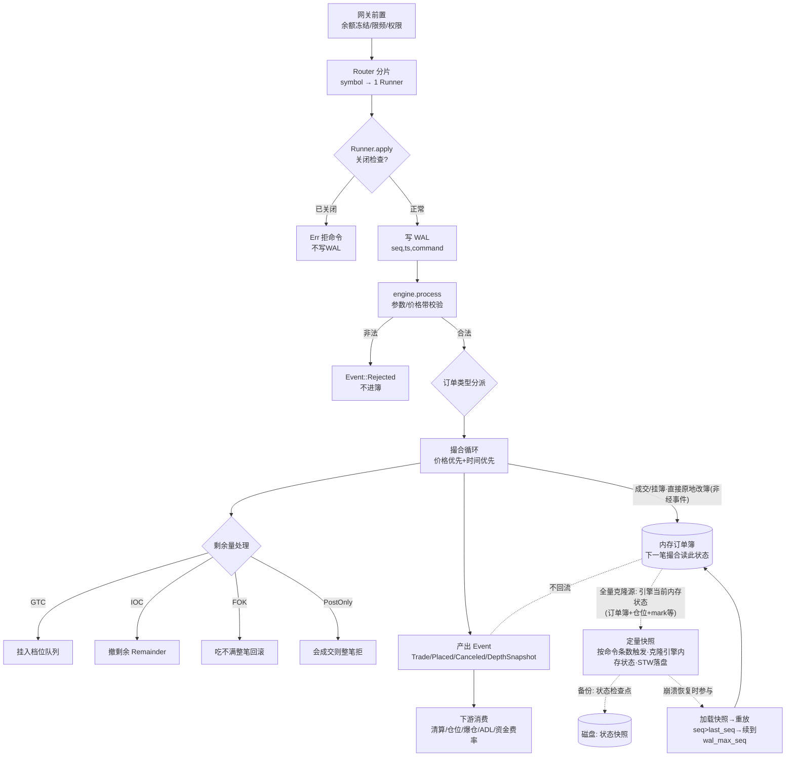
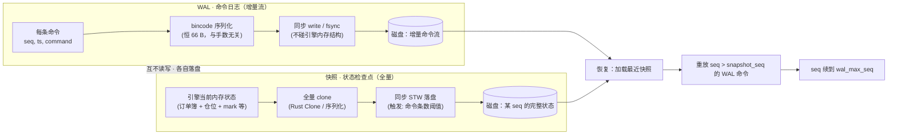

# 09 · 业务流程总览

> 本文把"一笔命令从网关进来、到下游消费、再到崩溃恢复"的完整链路画清楚。
> 每一层都标注了**分支条件**和**代码位置**，是 `src/` 的地图。
> 与本文配套的底层细节：订单簿结构见 `01`，持久化与恢复见 `03`，内存模型见 `07`，快照选型见 `08`。

---

## 0 · 一句话定位

撮合引擎是一条**单线程、事件溯源、先落盘后执行**的流水线：

```
命令 → 校验/价格带 → 写 WAL → 内存撮合 → 事件输出 → 下游消费
                                          └→ 快照/重放（旁路）
```

引擎**只管撮合与簿状态**，不管余额、不收手续费、不读时钟、不碰随机数。
钱、风控、行情分发都在它外面。这是它能做到*纯确定性、可重放*的根本原因。

---

## 1 · 总览流程图



> ⚠️ 图里三条**虚线**均与"持久化旁路"相关：`N -.→ P` 表示快照**全量克隆的是引擎当前内存状态**（不是 WAL 拷页）；`P -.→ PD` 表示克隆结果**落盘为状态检查点**；`P -.→ Q` 表示快照**只在崩溃恢复时被读取重放**，平时不参与撮合、也不回写簿。快照与 WAL 是两条独立支柱，详见 §⑦‑1。

---

## 1.5 · 流程图节点 → 代码方法对照（逐节点定位）

下表把图里每个节点（字母对应 mermaid 图）锚定到具体方法与行号，方便"看图即能翻代码"。
**调用链主入口**：`Router::apply`（`router.rs:115`）→ 按 `symbol` 取对应 `Runner` → `Runner::apply`（`runner.rs:169`）→ `Engine::process`（`engine.rs:121`）。

| 节点 | 图中含义 | 具体做什么 | 对应代码方法 / 位置 |
|---|---|---|---|
| **A** | 网关前置<br/>余额冻结/限频/权限 | **引擎之外**的接入层。余额冻结、限频、权限校验全部在引擎前完成，引擎不碰余额。 | 不在引擎内。`Runner::apply`（`router.rs:169`）只接收已通过的 `Command`。 |
| **B** | Router 分片<br/>`symbol → 1 Runner` | 按交易对 `symbol` 把命令路由到对应 `Runner` 实例；一品种一 `Runner`，物理隔离（各自簿/WAL/快照目录/写缓冲）。**这是"品种分派"，不是"订单类型分派"**。 | `Router::apply`（`router.rs:115`）→ `BTreeMap<String, Runner>::get_mut(&symbol)`；`Router` 持有 `BTreeMap<String, Runner>`。 |
| **C** | `{Runner.apply 关闭检查?}` | 进入 `apply` 第一件事：检查 `shutting_down`。已关闭则直接 `Err`，**不分配 seq、不写 WAL、不进 engine**（见 §② 顺序）。 | `Runner::apply`（`runner.rs:169`）→ `runner.rs:171` `if self.shutting_down`。 |
| **Z** | `Err` 拒命令<br/>不写 WAL | 关闭检查命中的出口。命令未被编号、未落盘、未撮合；上游收到 `Err` 后提示"维护中"或路由他机。 | `runner.rs:171-173` 的 `return Err(...)` 分支。 |
| **D** | 写 WAL<br/>`seq,ts,command` | 分配 `seq`（每品种 +1）→ 组装 `WalRecord{seq,ts,command}` → `append` 同步落盘（`flush` 进页缓存，`sync_each` 才 `fdatasync`）。只记命令不记事件，增量恒 66 B。 | `runner.rs:175-192`（`seq += 1` + `WalRecord` + `p.wal.append`）；`WalWriter::append`（`wal.rs:152`）；坏帧自愈 `repair_truncate`（`wal.rs:215`）。 |
| **E** | `engine.process`<br/>参数/价格带校验 | 调 `process(command)`，内部 `place()` 先做参数校验（`validate`）再做价格带（`band_check`）。**此刻 WAL 已写**，校验失败也产出 `Rejected` 事件（命令仍留 WAL）。 | `runner.rs:194` `engine.process` → `engine.rs:121` `process` → `engine.rs:211` `place` → `validate`（`engine.rs:491`）+ `band_check`（`engine.rs:178`，调用处 `engine.rs:221`）。 |
| **R** | `Event::Rejected`<br/>不进簿 | `validate` / `band_check` / PostOnly / FOK 任一失败的结果事件。订单不进簿、不撮合，但 WAL 已记录此命令（重放时确定性再拒）。 | `engine.rs:217`（参数）、`225-229`（价格带）、`244-247`（PostOnly）、`253-256`（FOK）四处 `Rejected` 返回，`place` 产出。 |
| **F** | `{订单类型分派}` | **两层**：① 命令类型 `match cmd`（`Place`/`Cancel`/`Batch`）；② 订单类型（在 `place` 内按 `req.kind` 限价/市价/PostOnly + `req.tif` GTC/IOC/FOK）决定撮合与剩单策略。 | ① `engine.rs:122` `match cmd`；② `engine.rs:238-257` PostOnly/FOK 前置判定 + `req.kind`/`req.tif` 分支。 |
| **G** | 撮合循环<br/>价格优先+时间优先 | `while` 还有量且仍 crossing → 取对手最优价（买盘 `BidKey` 反转 `Ord` 高→低、卖盘 `BTreeMap` 升序，价格优先）→ 同价档 `VecDeque` 队首（时间优先）→ 逐笔吃单产 `Trade`。含 STP 自成交处理、冰山 `refill`。 | `engine.rs:264` `while remaining > 0` 主循环；`book.crossing_price`（`book.rs:168`）、`counter_level_mut`（`book.rs:200`）+ `level.queue.pop_front()`；`Trade` 推送 `engine.rs:317`；STP `engine.rs:280`。 |
| **H** | `{剩余量处理}` | 撮合循环结束后，按订单类型处理剩余未成交部分的分派点（具体落到 I/J/K/L 四分支）。 | `place` 内撮合循环之后（见各分支）。 |
| **I** | 挂入档位队列 | GTC：剩余量挂入对应价格档队列，成为 resting order，同时更新撤单索引 `index`。 | `book.insert`（`book.rs:226`）+ `Placed{remaining}`（`engine.rs:384`/`400`）；`index` 维护在 `place` 内。 |
| **J** | 撤剩余 Remainder | IOC / 市价单吃剩部分不挂簿，直接 `Canceled{reason: Remainder}`。 | `engine.rs:393` `Canceled{reason: Remainder}`。 |
| **K** | 吃不满整笔回滚 | FOK：可见流动性 `< qty` 则**整笔拒绝、一笔不成交**。⚠️ 图放 H 下是逻辑简化——**实际在撮合循环之前的前置判定**，并非先成交再回滚。 | `engine.rs:249-256` `InsufficientLiquidity` 前置判定（循环前）。 |
| **L** | 会成交则整笔拒 | PostOnly：若会立即交叉成交则**整笔拒绝** `PostOnlyWouldCross`。⚠️ 同上，是循环前的前置判定。 | `engine.rs:238-248` `PostOnlyWouldCross` 前置判定。 |
| **N** | `(内存订单簿)`<br/>下一笔撮合读此状态 | 订单簿（`OrderBook`），撮合核心**直接原地 mutate**，单一真相源。下一笔 `process` 读已改状态，与事件无关。 | `book.rs:142` `OrderBook`（BTreeMap 价格档 + VecDeque 队列）；`insert`（226）/`counter_level_mut`（200）/`remove_counter_if_empty`（209）原地改；`index` 撤单索引 `HashMap`。 |
| **M** | 产出 Event<br/>Trade/Placed/Canceled/DepthSnapshot | `process` 返回 `Vec<Event>`，**顺序即下游结算顺序**。每笔末附 `DepthSnapshot`（前 N 档，供行情）。 | 各事件推送：`Trade`（`engine.rs:317`）、`Placed`（`384`/`400`）、`Canceled`（`288`/`393`）、`DepthSnapshot`（`engine.rs:409`，读自 `depth` `engine.rs:198`）。 |
| **O** | 下游消费<br/>清算/仓位/爆仓/ADL/资金费率 | 事件投 `trades` topic，引擎外的下游按序消费（清算、仓位、`i128` 防溢出、爆仓扫描、ADL、资金费率）。 | 投递 `kafka.rs:70` 到 `trades_topic`；下游 `liquidation.rs:183` `apply_fill`、爆仓扫描 `liquidation.rs`、`adl.rs:135` `apply_adl`、`funding.rs`（资金费率）、`futures_types.rs:190` `apply_fill`（仓位）。 |
| **P** | 定量快照<br/>按命令条数触发 | `apply` 内 `cmds_since_snapshot` 计数达 `snapshot_every`，当场 STW 全量 `clone` 引擎状态 + 落盘（同线程同步）。 | `Runner::apply` 内计数（`runner.rs:196-201`）+ `Runner::take_snapshot`（`runner.rs:238`）；`EngineSnapshot::snapshot`（全量 clone，`snapshot.rs:81`）+ `save_snapshot`（`snapshot.rs:125`）。 |
| **Q** | 加载快照→重放<br/>`seq>last_seq`→续到 `wal_max_seq` | 崩溃恢复：加载最近快照 → 重放 `seq > snapshot_seq` 的 WAL 命令补齐增量 → `seq` 续到 `wal_max_seq`（修复过"续到 `snapshot_seq` 导致重复重放"的 bug）。 | `recover`（`runner.rs:269`，`RecoveryResult.wal_max_seq`）；`WalReader`（`wal.rs:174`）重放；`load_snapshot`（`snapshot.rs:145`）。 |

### ⚠️ 图与实现的两处微差（读图务必注意）

1. **FOK（K）与 PostOnly（L）实际在撮合循环之前的前置判定阶段就整笔拒**（`engine.rs:238-256`），并非"先撮合再回滚"。图里把它们画在 `H{剩余量处理}` 之下，是逻辑简化的画法——因为从"整单生死"的结果看，它们确实属于"这张单最终怎么处理"的家族，但实现上**早于第一条 `Trade`**，以保证原子语义（见 §④ 注释）。
2. **节点 A（网关前置）不在引擎代码内**，是接入层职责；引擎只接收已通过前置的 `Command`。所以"余额冻结/限频/权限"没有对应的引擎方法，是 `Router::apply` 之前的事。

---

## 2 · 逐层详述

### ① 接入层（`router.rs`）

| 项 | 说明 |
|---|---|
| 网关前置 | 余额冻结、限频、权限校验**全部在引擎外**。引擎不碰余额。 |
| 分片粒度 | `symbol → 1 个 Runner → 1 套订单簿 + WAL 目录 + 快照目录 + 1 个写缓冲`。品种间完全隔离。 |
| 编号 | 每个 Runner **各自从 1 开始编号**（`seq` 不是全站统一），跨品种的全局回放目前做不到。 |
| ⚠️ 隐患 | 目录名用 `symbol.replace(['/','\\',':'], "_")`，`BTC/USDT` 与 `BTC_USDT` 会撞到同一目录。生产需 symbol 注册表（symbol → 稳定 id）。 |

### ② 命令预处理（**顺序是最容易记错的点**）

- **关闭检查在 `apply()` 最前面** → 命中即 `Err`，**不写 WAL**。
- **参数校验 / 价格带校验在 `engine.process()` 里** → 此时 WAL **已经写了**。

所以：**非法命令也会进 WAL**，重放时同样产出 `Rejected`。这是必须的——否则重放时"这条命令存不存在"对不上。

- 价格带（`price_band.rs`）两种策略：
  - `Reject`：超带直接拒；
  - `Clamp`：把价格夹回带内（按标记价 ±bp 计算，**整数基点，不用浮点**）。

### ③ 持久化 WAL（`wal.rs`）

| 步骤 | 细节 |
|---|---|
| 分配 seq | 每条 +1，**每品种一套**编号，非全站统一 |
| 记录内容 | `WalRecord{seq, ts, command}`——**只记命令，不记事件**（手数再大，WAL 增量恒 66 B） |
| 帧格式 | `[u32 len][u32 crc32][bincode 数据]`；CRC32 自实现查表，零依赖 |
| 落盘 | 每次必 `flush()`（推出用户态缓冲）；`sync_each=true` 才 `fdatasync` |
| 自愈 | 读端遇坏帧即视为崩溃截断；写端重开时 `repair_truncate` 物理切掉残帧 |

**实测代价**（`src/bin/io_bench.rs`，N=2 万条）：

| 模式 | 每笔 | TPS |
|---|---|---|
| 纯撮合不落盘 | 375 ns | 267 万 |
| 撮合 + WAL（只 flush 进页缓存） | 3.1 µs | 32 万 |
| 撮合 + WAL（每笔 fsync） | 1.07 ms | **935** |
| 单次 fsync 裸成本 | **287 µs** | — |

> 结论：默认配置（只 write 不 fsync）**不是**瓶颈；`sync_each=true` 才是，且当前缺 group commit 中间档。详见 `03-运维手册.md §2.2`。

### ④ 撮合核心（`engine.rs` / `book.rs`）

- **类型分派**：Limit / Market / PostOnly / IOC / FOK / Iceberg 六种。
- **取对手最优价**：买盘用自定义 `BidKey` 反转 `Ord`，`iter()` 天然从高到低；卖盘 `BTreeMap` 升序。**"谁看谁 / 成交价取 maker"的视角与判定细节见 ④‑1。**
  - ⚠️ 不用 `HashMap` 存价格档：其 `RandomState` 每次进程种子不同，迭代顺序会变 → 毁掉确定性重放。撤单索引 `index` 可用 HashMap（只点查、不遍历）。
- **撮合循环**：`while` 还有量且仍 crossing → 价格优先（沿 BTree）→ 时间优先（`VecDeque` 队首）→ 逐笔产 `Trade`。
- **STP 自成交**：`None` / `CancelMaker` / `CancelTaker`，决定同用户自成交时砍哪边。
- **剩余处理**（四条分支，在撮合循环结束后）：
  - GTC → 剩余量挂入档位队列；
  - IOC → 剩余量撤掉，`CancelReason::Remainder`，**不进簿**；
  - FOK → 吃不满则**整笔回滚**，一笔不留；
  - PostOnly → 会立刻成交则整笔拒绝。
- **簿维护**：档位队列吃空即删档（`remove_counter_if_empty`，防空壳档占内存）；冰山单 `refill()` 按 `splitmix64(id, refill_count)` 确定性抖动后补量并排队尾；撤单索引同步。
- 每笔 `process()` 末附带一个 `DepthSnapshot`（前 N 档）。

#### ④‑1 · 谁看谁：taker 探对手盘，成交价取 maker（价格改进）

> 撮合里最容易想反的一点：**不是 maker 去看 buyer，而是刚进来的主动单（taker）去探挂在簿上的对手 maker 单的最优价。** maker 是被动躺在簿上的，它不"看"任何人；是 taker 主动发起、被匹配到 maker 身上。

- **taker（吃单 / 主动方）** = 刚进 `process()` 的那笔 `req`，带着方向 + 限价来"主动成交"。
- **maker（挂单 / 被动方）** = 早就躺在 `book` 里的休息单。它被动等待，**不主动发起、也不"看"任何人**；是 taker 去吃它的流动性。

`crossing_price`（`book.rs:168`）就是 taker 开工前先探一眼"对手盘最优价我够不够得着"。规则只有一条：**taker 的限价 vs 对手盘 maker 的最优价**：

| taker 方向 | 探的是哪个对手盘 | 够得着的条件 | 返回（即成交价） |
|---|---|---|---|
| 买（Buy） | 卖盘 `best_ask`（最低卖价） | 限价 `p >= best_ask` | 返回 `best_ask`（maker 价） |
| 卖（Sell） | 买盘 `best_bid`（最高买价） | 限价 `p <= best_bid` | 返回 `best_bid`（maker 价） |
| 市价（无价） | 任意对手盘 | 对手有货即够得着 | 返回对手最优价 |

⚠️ **成交价取的是 maker 的价，不是 taker 的限价**：限价买 `105`、对手最优卖 `100` → 按 `100` 成交（taker 拿到"价格改进"，少付）；限价卖 `95`、对手最优买 `99` → 按 `99` 成交。这是交易所标准规则（maker 价优先），对应主循环 `engine.rs:279` 拿 `crossing_price` 返回的 `level_price`（= maker 价）去吃单，taker 不会按自己更高的限价去"多付"。

**例子**（簿上 asks `100/101/102`，bids `99/98`）：

| 进来的 taker | 判定 | 结果 |
|---|---|---|
| 限价买 `100.5` | `100.5 >= best_ask(100)` ✅ | 按 `100` 吃 maker |
| 限价买 `99.5` | `99.5 >= 100` ❌ 返回 `None` | 够不着，自己挂成 maker（bid `99.5`） |
| 限价卖 `98.5` | `98.5 <= best_bid(99)` ✅ | 按 `99` 卖给 maker |
| 市价买（无价） | 有 ask 即 ✅ | 从 `100` 起一路向上吃 |

> 🔑 一句话：taker 的限价去比对手盘 maker 的最优价；够得着就按 **maker 的价**成交，够不着这单自己变成 maker 挂上去。maker 全程被动。顺便：PostOnly（`engine.rs:238-248`）也是用 `crossing_price` 先探——只要"够得着"就直接 `Rejected`，因为 PostOnly 规定绝不能交叉。

### ⑤ 事件输出

`Event` 六种：`Trade`（含 maker/taker 费率角色，**引擎只标角色不收钱**）、`Placed`、`Canceled`、`Rejected`、`Batch(Vec<Event>)`、`DepthSnapshot`。
批量命令原子——全成或全拒（`order_id=0` 表示整批）。

> ⚠️ **事件不回写订单簿**：内存订单簿由 `process` 撮合核心（成交减簿、GTC 剩余挂簿）**直接原地修改**；`Event` 只是改完之后打出的"已发生"报告，**只流向下游**（清算/仓位/行情，即 `kafka.rs` 投到 `trades` topic），**不回流**进簿。下一笔撮合读的是已改好的簿，与事件无关。把事件当成"更新簿的输入"是本末倒置——事件描述的是结果，不是指令。

### ⑥ 下游消费（**全部在引擎外**）

| 环节 | 说明 |
|---|---|
| 现货清算 | 成交 → 资金交割，在引擎外 |
| 仓位与保证金 | 逐仓 / 全仓；阶梯维持保证金；`i128` 防溢出（`futures_types.rs`） |
| 爆仓扫描 | 按**标记价**触发，不按最新成交价（防插针）（`liquidation.rs`） |
| 保险基金 | 穿仓缺口先由基金兜底 |
| ADL | 基金盖不住才分摊，三级排序：收益率 → 杠杆 → user_id（`adl.rs`） |
| 资金费率 | 按 `(symbol, settle_ts)` 幂等，重复结算不重复扣钱（`funding.rs`） |

### ⑦ 旁路：快照与恢复

- **触发**：按**命令条数**（`snapshot_every`），不是定时器——撮合核心禁读时钟。
- **代价实测**：10 万单 121.8 ms、100 万单 **1.4 s** 停摆；内存峰值 **2.59×**（`book.clone()` + 整块序列化）。这是全系统最大的同步 IO 停顿，比 WAL 严重。
- **恢复链路**：加载快照 → 重放 `seq > last_seq` → **seq 续到 `wal_max_seq`**（曾 bug：续到 `last_seq` 导致订单重复重放，已修，见 `tests/replay.rs::恢复后seq必须接续到WAL末尾而非快照点`）。

#### ⑦‑1 · 两条持久化支柱的边界（WAL 不拷内存页）

§⑦ 把快照画成 WAL 的旁路，容易让人误以为"快照是靠 WAL 拷一份内存页做出来的"。**不是。** WAL 和快照是**两条相互独立**的持久化支柱，谁也不读谁的运行时内存：



| 维度 | WAL | 快照 |
|---|---|---|
| 记什么 | **命令**（`{seq, ts, command}`） | **状态**（引擎在某一 seq 的完整内存副本） |
| 是否拷内存页 | **否**——只序列化命令字节流，不碰订单簿结构 | **是**——但拷的是引擎自身状态，来源是引擎、**不是 WAL** |
| 触发 | 每条命令必写 | 按 `snapshot_every` 命令条数阈值 |
| 落盘方式 | 同步（flush + 可选 fsync） | 同步 STW（全量 clone + 落盘，同线程） |
| 容量增长 | 随命令数线性增长 | 每次一份全量，覆盖式写盘 |

**恢复时二者如何配合**：崩溃后先加载**最近一次快照**（状态检查点），再从 WAL 重放 `seq > snapshot_seq` 的命令补齐增量，最后 `seq` 续到 `wal_max_seq`。快照是"存档"、WAL 是"存档之后的操作记录"——**快照的副本直接来自引擎状态，不经过 WAL**。

> 🔑 一句话记住：**真正"拷一份"的动作发生在快照里（就是那 1.4 s 停摆 / 内存峰值 2.59× 的来源），而且是在主线程当场同步做的 STW，不是"WAL 拷页 → 丢给后台慢慢写"**。（"拷一份交后台异步写"是当初排除的双缓冲 / fork+COW 升级路径，非当前方案。）

---

## 3 · 三处真实短板（读图时务必记住）

| 短板 | 影响 | 位置 |
|---|---|---|
| **无 group commit** | `sync_each=true` 时 935 TPS，安全与吞吐之间缺中间档 | `wal.rs` |
| **`positions` 按 `user_id` 建键** | 同一用户跨品种持仓会互相覆盖，既是内存问题也是功能缺陷 | `liquidation.rs` |
| **无交易元数据校验** | tick/lot size 传错会造出脏价格档，引擎不报错 | 缺 `Instrument` 配置层 |

---

## 4 · 相关文档

- `01-撮合引擎设计与实现.md` —— 订单簿结构、撮合算法、事件模型
- `03-运维手册.md` —— 配置项、恢复 runbook、WAL 持久化短板
- `07-内存与容量规划.md` —— 内存三自变量、快照峰值、容量公式
- `08-快照方案选型.md` —— STW / fork+COW / 双缓冲 / 持久化结构 四类对比（待补）
